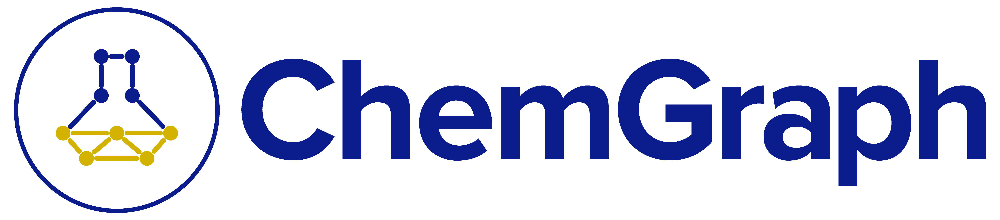

<p align="left">
  
</p>

[English](README.md) | 简体中文

[](https://pypi.org/project/chemgraph/)
[](https://pypi.org/project/chemgraph/)
[](LICENSE)

# ChemGraph Client(客户端版)

本仓库是 [argonne-lcf/ChemGraph](https://github.com/argonne-lcf/ChemGraph)(上游 v0.7.0)的**客户端构建**,在上游基础上增加了面向"本地 + 远程算力"协作的功能:

- **计算位置开关**:Streamlit 侧边栏可一键切换"本地计算 / 远程 MCP 服务器计算",远程端点地址由用户自行修改,并带健康探测
- **远程产物镜像**:远程计算产生的 xyz / traj / json 等文件自动回传到本机,下载按钮、产物清单、3D 可视化的呈现与本地计算完全一致

ChemGraph 是面向计算化学与材料科学的智能体框架,将自然语言请求连接到分子构建、模拟、分析和报告工具,基于 LangGraph、ASE、RDKit 和模型上下文协议(MCP)构建。

> ChemGraph 可以启动计算并写入文件。在依赖某个结果之前,请先检查生成的输入、计算器设置、收敛情况、单位和科学结论。

## 快速开始

ChemGraph 需要 Python 3.11 或更高版本。建议使用虚拟环境:

```bash
python -m venv .venv
source .venv/bin/activate              # Windows: .venv\Scripts\activate
python -m pip install --upgrade pip
python -m pip install chemgraph
```

选择一个模型提供方并配置它需要的凭据(默认模型为 `gpt-4o-mini`):

| 提供方 | 配置 | 模型示例 |
| --- | --- | --- |
| OpenAI | `export OPENAI_API_KEY="..."` | `gpt-4o-mini` |
| Anthropic | `export ANTHROPIC_API_KEY="..."` | `claude-3-5-haiku-20241022` |
| Google | `export GEMINI_API_KEY="..."` | `gemini-2.5-flash` |
| Groq | `export GROQ_API_KEY="..."` | `groq:<model-id>` |
| Ollama | 本地启动 Ollama,无需 API key | `llama3.2` |

检查安装并运行一个使用工具的小查询:

```bash
chemgraph --help
chemgraph models
chemgraph run --check-keys
chemgraph run -q "What is the SMILES string for aspirin?"
```

第一次计算建议显式选择轻量的 EMT 计算器:

```bash
chemgraph run \
  -q "Build water from SMILES O, optimize it with EMT, and report the final energy." \
  --output last_message
```

ChemGraph 默认在 `cg_logs/` 下创建会话目录,XYZ 结构、JSON 结果、轨迹、光谱和 HTML 报告等工具输出都写在这里。启动前设置 `CHEMGRAPH_LOG_DIR` 可更换产物目录。

## 🖥️ 远程算力服务器(MCP)——重点功能

把计算量大的任务(如 MACE 频率、批量筛选)放到局域网内另一台高性能机器上执行,本机只负责界面和 LLM 决策。

### 服务端(高性能机器)

在装好 ChemGraph 的环境里启动通用工具服务器:

```bash
# Linux / macOS
CHEMGRAPH_LOG_DIR=/path/to/artifacts \
.venv/bin/python -m chemgraph.mcp.mcp_tools \
  --transport streamable_http --host 0.0.0.0 --port 9003

# Windows
set CHEMGRAPH_LOG_DIR=E:\PyEnvs\chemgraph
.venv\Scripts\python.exe -m chemgraph.mcp.mcp_tools --transport streamable_http --host 0.0.0.0 --port 9003
```

关键点:

- `--host 0.0.0.0` 才能接受局域网连接(`127.0.0.1` 只监听本机)
- MCP 端点固定为 `http://<服务器IP>:9003/mcp/`
- 记得在防火墙放行 9003 端口
- 服务器额外提供两 条产物通道:`read_artifact` MCP 工具(供智能体查看小文件内容)和 `GET /artifacts/<文件名>` HTTP 端点(供批量下载大文件);两者都限制在产物根目录内,拒绝目录穿越

### 客户端方式一:网页 UI 开关(推荐)

启动 Streamlit 界面后,侧边栏有 **🖥️ Compute Location(计算位置)** 组件:

- 选择 `🖥️ 远程计算`,在输入框里填端点(支持 `192.168.12.44:9003` 这样的简写,自动补全 `/mcp/` 路径),回车即生效,无需重启
- 输入框旁的圆点显示实时健康状态:🟢 可达 / 🔴 不可达(不可达时自动停在本地计算,不会静默失败)
- **产物自动落地**:远程计算的 xyz / traj / json 文件会自动从服务器的 `/artifacts/` 端点回传到本机会话目录的 `remote_artifacts/` 下,回复中的路径即本地路径——下载按钮、产物清单和 3D 可视化与本地计算完全一致

### 客户端方式二:命令行

```bash
chemgraph run \
  --mcp-url http://192.168.12.44:9003/mcp/ \
  -q "Build a 3D structure for methane."
```

或写进 `config.toml`,以后每次运行自动挂载远程工具:

```toml
[mcp]
url = "http://192.168.12.44:9003/mcp/"
server_name = "ChemGraph Remote Tools"
```

> 注意:命令行方式下,LLM 端点仍需通过 `-m` / `--base-url` 或环境变量指定;`config.toml` 的 `[mcp]` 只管工具挂载,不决定 LLM 端点。CLI 方式不自动回传产物,文件保留在服务器端。

### 远程计算的取舍

| 优势 | 代价 |
| --- | --- |
| 重计算(MACE、批量任务)不占用本机资源 | 依赖网络与对方机器的可用性,无自动降级 |
| 本机只出 LLM 决策,笔记本也能跑大任务 | 产物在服务器端,需要网络回传(CLI 方式)或镜像(UI 方式) |
| 多台机器可按 IP 随时切换 | 端点无鉴权,仅限可信局域网使用 |

## 常用方式

### 单次查询

`single_agent` 是默认工作流,也是最好的起点:

```bash
chemgraph run \
  --model gpt-4o-mini \
  --workflow single_agent \
  --query "Calculate the vibrational frequencies of water with EMT."
```

常用运行选项:

| 选项 | 用途 |
| --- | --- |
| `-m`, `--model` | 选择 LLM 提供方/模型标识 |
| `-w`, `--workflow` | 选择智能体工作流 |
| `-o`, `--output` | 返回完整 `state` 或仅 `last_message` |
| `-s`, `--structured` | 请求结构化最终输出 |
| `-r`, `--report` | 允许生成 HTML 报告 |
| `--human-supervised` | 允许受支持的工作流暂停等待输入 |
| `--output-file` | 将 CLI 响应保存到文件 |
| `-v` / `-vv` | 启用 INFO / DEBUG 诊断 |

### 交互模式

```bash
chemgraph run --interactive
```

交互 shell 内用 `/help` 列出命令。会话保存在 `~/.chemgraph/sessions.db`,也可从 CLI 查看:

```bash
chemgraph session list
chemgraph session show <session-id>
chemgraph run --resume <session-id> -q "Continue with a frequency calculation."
```

`main_agent` 工作流是带持久检查点的长期监督者,必须交互使用:

```bash
chemgraph run --interactive --workflow main_agent
chemgraph run --interactive --workflow main_agent --resume <session-id>
```

### Python API

`ChemGraph.run()` 是异步的:

```python
import asyncio

from chemgraph.agent.llm_agent import ChemGraph


async def main():
    agent = ChemGraph(
        model_name="gpt-4o-mini",
        workflow_type="single_agent",
        return_option="last_message",
    )
    result = await agent.run("What is the SMILES string for aspirin?")
    print(result.content)


asyncio.run(main())
```

### Streamlit 网页界面

入口在源码树中,从仓库检出目录运行:

```bash
git clone https://github.com/zhengliushuai/ChemGraph-Client.git
cd ChemGraph-Client
python -m venv .venv
source .venv/bin/activate
python -m pip install -e .
chemgraph ui
```

打开 `http://localhost:8501`。`chemgraph ui` 首次运行会有邮箱提示,无头方式可用:

```bash
python -m streamlit run src/ui/app.py --server.headless true --server.port 8502
```

## 选择工作流

| 工作流 | 适用场景 | 重要前提 |
| --- | --- | --- |
| `single_agent` | 通用分子查询、ASE 计算与报告 | 默认且推荐首选 |
| `main_agent` | 带委托的长期监督者 | 交互模式;Python 中用 `MainAgentSession` |
| `multi_agent` | 规划/执行分解与并行子任务 | 模型调用与编排开销更大 |
| `python_relp` | LLM 驱动的 Python 与算术 | 在 ChemGraph 进程内执行 Python;仅用于可信提示 |
| `molecular_docking` | 基于 AutoDock Vina 的对接 | `docking` extra 及 conda-forge 的 Vina |
| `rag_agent` | 结合 PDF/文本文档的化学查询 | `rag` extra;嵌入模型或 OpenAI embeddings |
| `single_agent_xanes` | XANES 数据检索、模拟与绘图 | `xanes` extra、`MP_API_KEY` 和/或 `FDMNES_EXE` |
| `graspa` | gRASPA 吸附工作流 | 站点专属 gRASPA 可执行程序 |
| `graspa_mcp` | 使用给定 MCP 工具的规划/执行工作流 | 高级集成;须提供 MCP 工具 |
| `mock_agent` | 单遍工具调用实验 | 主要用于开发与评估 |

## 计算器与可选依赖

核心安装包含 ASE、EMT 和 MACE。ChemGraph 在启动时检测计算引擎与外部可执行程序,只暴露当前环境中可用的计算器。

| 能力 | 安装方式 | 说明 |
| --- | --- | --- |
| EMT | 核心安装 | 轻量;适合流程检查,不用于高精度化学 |
| MACE | MACE-MP 在核心包;Polar 可选 | 装了 Polar 加件默认用 MACE-Polar medium,否则 MACE-MP |
| TBLite / xTB | `pip install "chemgraph[calculators]"` | 无轮子时可能需要 Fortran 工具链 |
| UMA / FAIRChem | `pip install "chemgraph[uma]"` | 与 MACE 的 `e3nn` 冲突时分开环境 |
| NWChem / ORCA / AIMNet2 | 单独安装 | 须在 `PATH` 上或通过 ASE 配置 |

## 从源码安装 / Docker / Kubernetes / HPC

- 从源码安装用于开发、notebook 和 Streamlit UI(见上节)
- 上游发布的 [Docker 镜像](https://github.com/argonne-lcf/ChemGraph/pkgs/container/chemgraph) 支持 CLI、Streamlit、MCP 和 JupyterLab
- 仓库含 Streamlit UI 与 MCP 服务器的 K8s 部署模板(需按集群审查)
- 本地进程、Parsl、Ensemble Launcher、Globus Compute 等可插拔执行后端以及 Academy 多智能体运行时需要额外依赖与站点配置

详见[上游完整文档](https://argonne-lcf.github.io/ChemGraph/)。

## 配置

大多数首次运行只需命令行参数和环境变量。TOML 文件可用于提供方端点、MCP 连接、日志、UI 设置、评估配置与执行后端:

```bash
chemgraph run --config config.toml -q "What is the SMILES string for water?"
```

不要把 API key 或访问令牌写进会提交的 TOML 文件。

## 故障排查

```bash
chemgraph --help
chemgraph models
chemgraph run --check-keys
chemgraph run -vv -q "What is the SMILES string for water?"
```

- 启动时的计算器警告表示未检测到可选引擎,按需安装即可
- 首次 MACE 或本地嵌入运行可能因下载模型权重而暂停
- `main_agent` 需要 `--interactive`
- Streamlit 源码命令必须从仓库检出目录运行
- 旧版已安装包可能遮蔽源码检出;激活目标环境并使用可编辑安装
- 远程计算报连接错误:确认服务器已启动、9003 端口可达、端点路径以 `/mcp/` 结尾

## 文档与示例

- [上游完整文档](https://argonne-lcf.github.io/ChemGraph/)
- [MCP 服务器指南](https://argonne-lcf.github.io/ChemGraph/mcp_servers/)
- [评估与基准测试](https://argonne-lcf.github.io/ChemGraph/evaluation/)

## 引用

如果 ChemGraph 对你的研究有帮助,请引用:

> Thang D. Pham, Aditya Tanikanti, and Murat Keçeli. "ChemGraph as an
> agentic framework for computational chemistry workflows."
> *Communications Chemistry* 9, 33 (2026).
> <https://doi.org/10.1038/s42004-025-01776-9>

## 贡献与许可

欢迎贡献。从最新 `main` 拉分支,保持每次改动聚焦,提交 PR 前运行 `ruff check .` 与 `pytest tests/ -k "not tblite"`。

ChemGraph 以 [Apache License 2.0](LICENSE) 分发。
